# FOIL LAB — fonctionnement, architecture, stockage et accès

Document de référence opérationnel. Dernière vérification : **19 novembre 2026**.

Ce document décrit le fonctionnement réel du dépôt `ebarraud/FOIL-LAB`. Les rapports datés placés dans `research/` conservent l’historique des campagnes et audits ; ils ne remplacent pas cette vue d’ensemble.

## 1. Objectif

FOIL LAB est un configurateur indépendant d’aide au choix d’ailes avant et de boards de wingfoil. Il combine :

- le profil du pratiquant, ses conditions et son matériel existant ;
- les caractéristiques constructeur vérifiées ;
- des essais vidéo dont la transcription a réellement été lue ;
- des essais écrits dont le corps de l’article a réellement été lu ;
- des limites explicites quand la taille, le montage, la génération ou la langue restent incertains.

Le résultat attendu est une sélection restreinte et argumentée. FOIL LAB ne produit pas de mesure hydrodynamique et ne doit pas inventer de score, de compatibilité, de plage de vent ou de seuil de poids.

## 2. Principes non négociables

1. Une URL repérée n’est pas un essai analysé.
2. Un mot-clé dans une transcription n’est pas une conclusion technique.
3. Une traduction n’est pas un essai indépendant supplémentaire.
4. Une taille ou une génération testée ne valide pas automatiquement toute la famille.
5. Une fiche fabricant documente une géométrie ou une spécification déclarée ; elle ne remplace pas un essai indépendant.
6. Une transcription lue n’équivaut pas à une écoute ou à un visionnage intégral.
7. Les transcriptions intégrales, médias et clés d’accès ne sont pas publiés dans Git.
8. Toute intégration dans le moteur doit renvoyer à une preuve, à son montage et à ses limites.

La méthode de qualification des preuves est détaillée dans [`METHODOLOGY.md`](METHODOLOGY.md).

## 3. Architecture générale

FOIL LAB est un **site statique**. Il n’existe actuellement ni serveur applicatif, ni compte utilisateur, ni base SQL distante.

```mermaid
flowchart LR
    A[Veille vidéo et écrite] --> B[Références candidates]
    B --> C[Qualification du périmètre]
    C --> D[Collecte autorisée du texte]
    D --> E[Cache local non publié]
    E --> F[Lecture et synthèse sourcée]
    F --> G[Registres JSON publics]
    G --> H[Catalogue et règles conditionnelles]
    H --> I[Tests Python et JavaScript]
    I --> J[Branche main]
    J --> K[GitHub Pages public]
```



Le navigateur charge les pages HTML et les JSON publics directement depuis GitHub Pages. Le moteur principal reste dans `index.html`; des JSON complémentaires enrichissent les fiches, les sources et les preuves.

## 4. Pages visibles

| Page | Rôle |
|---|---|
| `index.html` | Configurateur, catalogue, sources, règles de recommandation et onglet « Wing et montage ». |
| `progress.html` | Tableau de bord des vidéos, éditeurs, langues, étapes, délais et améliorations. |
| `video-analysis/evidence.html` | Registre unifié des dossiers vidéo et écrits réellement documentés. |
| `video-analysis/reviews.html` | Lecture détaillée des analyses de transcriptions vidéo. |
| `video-analysis/review.html` | Import local d’un SRT/VTT/TXT horodaté et repérage de passages candidats dans le navigateur. Le texte importé n’est pas envoyé au dépôt. |

Site public : <https://ebarraud.github.io/FOIL-LAB/>

Dépôt public : <https://github.com/ebarraud/FOIL-LAB>

## 5. Chaîne de traitement des vidéos

### 5.1 Découverte

`video-analysis/discover.py` recherche des références Gleiten.TV et, si la clé est disponible, des vidéos via YouTube Data API. La découverte produit des métadonnées : titre, URL, date, éditeur et état d’accès. Elle ne prétend ni avoir visionné la vidéo ni avoir obtenu son texte.

`video-analysis/qualify.py`, `enrich_metadata.py` et `probe_batch.py` filtrent le périmètre, complètent les métadonnées publiques et contrôlent la disponibilité apparente des sous-titres. Un indicateur de sous-titres ne donne pas accès à leur contenu.

### 5.2 File de collecte

Les références éligibles sont dédupliquées par identifiant vidéo. Les traductions et originaux sont reliés par `data/research/translation_links.json`. Les exclusions sur métadonnées restent séparées des contenus effectivement lus.

La file locale et l’historique de collecte se trouvent sous `video-index/`, dossier ignoré par Git. Un résumé sans transcription intégrale est conservé dans `research/BATCH_STATUS.json`.

### 5.3 Collecte gratuite

`video-analysis/free_transcript_pilot.py`, `batch_transcripts.py` et `retry_transcripts.py` utilisent l’accès anonyme de FreeTranscriptAPI, sans clé et sans crédit payant.

Règles de collecte :

- attendre `retry_not_before_utc` avant tout nouvel appel ;
- espacer les requêtes ;
- arrêter la série sur 401, 403, 429 ou erreur serveur 5xx ;
- respecter `Retry-After` quand il est fourni ;
- marquer un HTTP 404 comme indisponible jusqu’à l’apparition d’une nouvelle source ;
- ne jamais transformer une erreur d’accès en « absence de transcription » certaine.

Les textes complets obtenus sont placés dans `.transcript-cache/` ou un autre cache local ignoré. Ils ne sont pas poussés sur GitHub.

### 5.4 Analyse

Une analyse valide exige la lecture du texte horodaté disponible. Les synthèses publiques contiennent seulement :

- le modèle, la taille et la génération attribuables ;
- le montage et le contexte connus ;
- des paraphrases courtes ;
- les bornes de temps ;
- l’empreinte SHA-256 de la transcription normalisée quand elle est disponible ;
- les ambiguïtés et limites ;
- la décision d’intégration ou le motif du report.

Les analyses sont stockées principalement dans `data/research/transcript_reviews.json`. Les trois pilotes historiques et certains registres spécialisés restent séparés, puis sont réunis à l’affichage par `evidence_library.js`.

## 6. Chaîne de traitement des essais écrits

`video-analysis/discover_written.py` consulte des flux RSS ou index publics et publie des **pistes**, pas des conclusions.

Pour devenir une preuve :

1. le corps de l’article doit être accessible et lu ;
2. l’auteur, le modèle, les tailles et le montage sont relevés quand ils sont présents ;
3. les observations sont paraphrasées brièvement ;
4. les usages seulement annoncés par le fabricant sont séparés des pratiques réellement essayées ;
5. les limites sont enregistrées ;
6. aucune copie intégrale de l’article n’est publiée.

Les dossiers lus et les fiches de catalogue associées sont enregistrés dans `data/research/expanded_test_evidence.json`. Les pistes encore non lues restent dans `written_review_leads_latest.json` et ne sont pas comptées comme essais analysés.

## 7. Passage d’une preuve au configurateur

Les données suivent trois niveaux :

1. **preuve documentée** : visible dans le registre, moteur inchangé ;
2. **conseil conditionnel** : montage, précaution ou limite affichée pour une taille précise ;
3. **sélection conditionnelle** : la taille peut entrer dans les recommandations, sous conditions explicites de niveau, programme et montage.

Les liens entre une preuve et une taille exacte se trouvent dans `data/research/catalogue_evidence_links.json`. Les règles conditionnelles sont tracées dans `conditional_integrations.json` et dans le code du moteur. Une règle n’est intégrée que si ses tests de non-régression passent.

Le catalogue est composé de deux ensembles :

- familles et tailles embarquées dans `index.html`, utilisées par le moteur ;
- fiches complémentaires de `expanded_test_evidence.json`, visibles dans le catalogue sans devenir automatiquement des recommandations.

`data/model_variants.json` contient une entrée par taille du moteur. Il est maintenu par `node video-analysis/sync_model_variants.js`, qui ajoute les tailles manquantes sans modifier les entrées existantes ; `test_catalogue.js` échoue en cas d’écart. Au chargement, ses métadonnées (confiance, génération, sources, dimensions) remplacent celles embarquées, puis les liens de preuve par taille sont appliqués. Aucune note n’est affichée actuellement. Une valeur `qualitative_scores: null` signifie qu’aucune note défendable n’est publiée.

### 7.0 Avis des essais vidéo sur les cartes

`video-analysis/build_review_family_map.py` rattache chaque lecture de `transcript_reviews.json` à une famille du moteur (même génération et construction) et écrit `data/research/review_family_map.json`. Chaque carte de recommandation affiche alors les observations minutées de ces essais, avec la taille de l’essai et les limites. Ces avis n’influencent ni la taille ni le classement. Relancer le script après toute nouvelle lecture ou toute nouvelle famille ; `test_catalogue.js` échoue si le fichier est périmé.

### 7.1 Repères de wing et de montage

L’onglet « Wing et montage » ne note aucun modèle. Il affiche des repères recopiés de sources datées et listés dans `data/research/expert_setup_guides.json` : taille de wing par poids et type de spot (SURF Magazin), plages de vent publiées d’un modèle de wing de référence (Duotone Unit 2026, poids de référence non publié), surface d’aile avant de contrôle (SURF Magazin), longueurs de mât et de fuselage (Duotone, SURF Magazin) et allongement visé. `test_expert_setup.js` vérifie que les constantes de `index.html` sont identiques au registre et que chaque source est citée. Aucune règle de taille de stabilisateur n’est publiée faute de source chiffrée.

## 8. Stockage

### 8.1 Données versionnées et publiques

Tout fichier commité dans ce dépôt public peut être lu par n’importe qui.

| Emplacement | Contenu |
|---|---|
| `index.html`, `progress.html`, `video-analysis/*.html/js` | Application et interfaces publiques. |
| `data/model_variants.json` | Variantes du catalogue et métadonnées de confiance. |
| `data/research/progress.json` | État public par vidéo, compteurs, éditeurs, langues et intégrations. |
| `data/research/transcript_reviews.json` | Synthèses minutées, empreintes et limites des textes lus. |
| `data/research/expanded_test_evidence.json` | Essais écrits lus et fiches complémentaires. |
| `data/research/catalogue_evidence_links.json` | Rattachement preuve → modèle → taille. |
| `data/research/translation_links.json` | Relations original/traduction. |
| `data/research/reference_decisions.json` | Décisions de qualification des références. |
| `research/BATCH_STATUS.json` | État de collecte et délais, sans texte intégral. |
| `research/*.md` | Rapports historiques et audits datés. |

### 8.2 Données locales non versionnées

Le `.gitignore` exclut :

- `.transcript-cache/` ;
- `video-analysis/transcript-cache/` ;
- `video-analysis/local-results/` ;
- `video-index/` ;
- les caches Python.

Ces emplacements peuvent contenir les textes intégraux, les fichiers de travail, les résultats intermédiaires ou l’historique détaillé des tentatives. Ils restent sur la machine de travail sauf transfert volontaire et autorisé.

### 8.3 Artefacts GitHub Actions

Les workflows de découverte peuvent conserver leurs inventaires comme artefacts GitHub pendant **14 jours**. Les sondes historiques de sous-titres utilisent une conservation de **7 jours**. Les artefacts ne sont pas la base publique du configurateur et peuvent expirer.

### 8.4 Secrets

Les valeurs secrètes sont stockées dans **GitHub → Settings → Secrets and variables → Actions**. Elles ne doivent apparaître ni dans Git, ni dans les rapports, ni dans une conversation.

| Secret GitHub actuel | Usage | Obligatoire |
|---|---|---|
| `YOUTUBE_APU` | Injecté par le workflow dans la variable `YOUTUBE_API_KEY` pour la découverte et les métadonnées YouTube. | Non ; sans lui, le volet YouTube est signalé inactif. |
| `TRANSCRIPT_API_KEY` | Ancien fournisseur TranscriptAPI payant, uniquement dans le workflow manuel avec confirmation explicite des frais. | Non ; le projet courant ne dépend pas de ce service. |

Le nom `YOUTUBE_APU` est le nom réellement utilisé par le workflow actuel, même si d’anciens documents mentionnent `YOUTUBE_API_KEY` comme nom du secret.

## 9. Accès et permissions

| Acteur | Lecture | Écriture / action |
|---|---|---|
| Visiteur Internet | Site GitHub Pages, dépôt public, code et JSON publics. | Aucune écriture. |
| Mainteneur GitHub | Tout le dépôt, historique, Actions et réglages autorisés par son compte. | Push sur `main`, lancement manuel des workflows, gestion des secrets et de Pages selon ses droits. |
| GitHub Actions — tests | Lecture du dépôt. | Aucun changement de contenu. |
| GitHub Actions — découverte | Lecture et accès réseau. | `contents: write` pour publier les nouvelles métadonnées dans `progress.json` ou l’index d’articles. |
| Processus local autorisé | Dépôt et caches présents sur la machine. | Analyse, mise à jour des JSON, tests et publication Git selon les identifiants Git disponibles. |

Il n’existe pas de formulaire public permettant à un visiteur de modifier la base. Le formulaire d’import traite le texte dans le navigateur et propose un export local.

## 10. Automatisations GitHub

| Workflow | Déclenchement | Fonction |
|---|---|---|
| `video-analysis.yml` | Push sur `main`, pull request, manuel | 84 tests Python, tests JavaScript du moteur, catalogue, preuves, liens et formulaires. |
| `discover-wingfoil.yml` | Lundi 07:10 UTC, manuel, changements du pipeline | Découverte vidéo, qualification, métadonnées, sondes, artefact 14 jours et mise à jour du tableau de bord. |
| `discover-written-reviews.yml` | Lundi 07:40 UTC, manuel, changements du pipeline | Découverte d’articles, artefact 14 jours et publication de l’index de pistes. |
| `free-transcript-pilot.yml` | Manuel | Petit essai anonyme et gratuit de transcriptions. |
| `hosted-transcript-pilot.yml` | Manuel uniquement | Ancienne option payante, bloquée sans clé et sans confirmation explicite. |
| `caption-acquisition.yml` | Manuel ou ancienne branche dédiée | Sonde historique de disponibilité ; ne publie aucune transcription. |

Les horaires GitHub sont en UTC : 07:10 correspond à 08:10 à Paris en hiver et 09:10 en été ; 07:40 correspond à 08:40 en hiver et 09:40 en été.

## 11. Publication

La branche de référence est `main`. Le dépôt est public et GitHub Pages publie la racine à l’adresse <https://ebarraud.github.io/FOIL-LAB/>.

Chaîne habituelle :

1. modifier les données ou le code ;
2. régénérer `data/research/progress.json` avec `python video-analysis/dashboard.py` ;
3. lancer les tests adaptés ;
4. commiter et pousser sur `main` ;
5. vérifier le succès de `Video Analysis Checks` et du déploiement Pages ;
6. vérifier le contenu réellement servi sur l’URL publique.

Commandes de validation complète :

```text
python -m unittest discover -s video-analysis -p "test_*.py" -q
node video-analysis/test_recommendations.js
node video-analysis/test_catalogue.js
node video-analysis/test_evidence_library.js
node video-analysis/test_site_links.js
node video-analysis/test_forms.js
node video-analysis/test_expert_setup.js
```

Le message d’aide imprimé par un test de protection du mode `fetch` est attendu ; la suite doit néanmoins se terminer par `OK`.

## 12. Sources de vérité et compteurs

Ne recopier aucun compteur dans plusieurs documents. Les valeurs courantes se lisent dans :

- `data/research/progress.json` pour les vidéos et leur état ;
- `research/BATCH_STATUS.json` pour la collecte ;
- `transcript_reviews.json` pour les analyses de transcriptions ;
- `expanded_test_evidence.json` pour les essais écrits ;
- `progress.html` et `evidence.html` pour la présentation publique calculée.

Les rapports datés peuvent conserver d’anciens nombres pour expliquer une campagne précise. Ils ne décrivent pas nécessairement l’état courant.

## 13. Reprise après incident

- **429 ou Retry-After** : enregistrer la date dans `BATCH_STATUS.json`, arrêter les appels et reprendre seulement après cette date.
- **401/403** : arrêter la série ; vérifier l’accès ou attendre un changement externe.
- **5xx** : traiter comme panne du fournisseur et appliquer le délai local enregistré.
- **404 sur une transcription** : ne pas relancer en boucle ; attendre une nouvelle source.
- **workflow de découverte réussi avec zéro résultat** : conserver ce résultat comme état d’accès, pas comme preuve d’absence de vidéos.
- **déploiement Pages incomplet** : vérifier d’abord les tests, le SHA publié et le contenu public avant de déclarer la mise à jour terminée.
- **cache local perdu** : les synthèses publiques restent lisibles, mais une nouvelle analyse complète exige de récupérer à nouveau un texte autorisé ; ne pas reconstruire des affirmations à partir des seuls extraits.

## 14. Propriété intellectuelle et données

- Aucun média tiers ni transcription intégrale ne doit être commité sans autorisation explicite.
- Les synthèses sont courtes, attribuées et accompagnées d’un lien vers la source.
- Les empreintes servent à identifier le texte analysé ; elles ne permettent pas de reconstituer le texte.
- Le nombre de vues, le référencement d’une chaîne et la présence d’un produit dans un catalogue ne constituent pas des preuves de performance.
- Les statuts doivent distinguer lecture complète, lecture ciblée de périmètre, présentation commerciale, traduction reliée, erreur d’accès et simple référence découverte.

## 15. Fichiers de maintenance

- `AGENTS.md` : règle opérationnelle de poursuite autonome du projet.
- `docs/METHODOLOGY.md` : méthode de preuve.
- `video-analysis/README.md` : documentation détaillée du pipeline vidéo et des outils locaux.
- `video-analysis/DISCOVERY.md` : découverte vidéo.
- `video-analysis/ACQUISITION.md` : sondes et acquisition autorisée.
- `research/CHANGELOG.md` : historique des évolutions documentaires.
- `research/AUDIT_*.md` : audits datés, utiles pour comprendre les corrections sans servir de configuration active.

En cas de contradiction, le code et les fichiers d’état courants décrivent ce qui s’exécute ; ce document doit ensuite être corrigé dans le même changement pour éviter qu’il dérive à nouveau.
